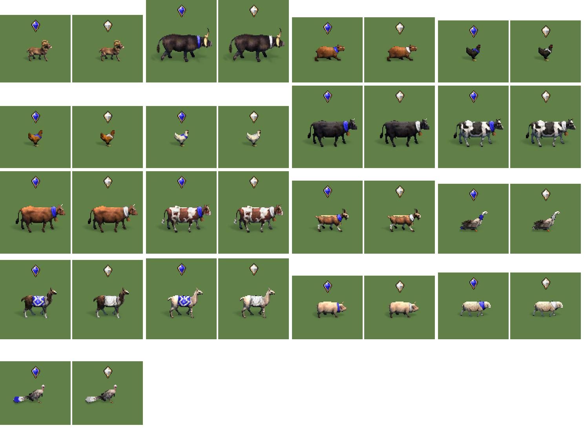
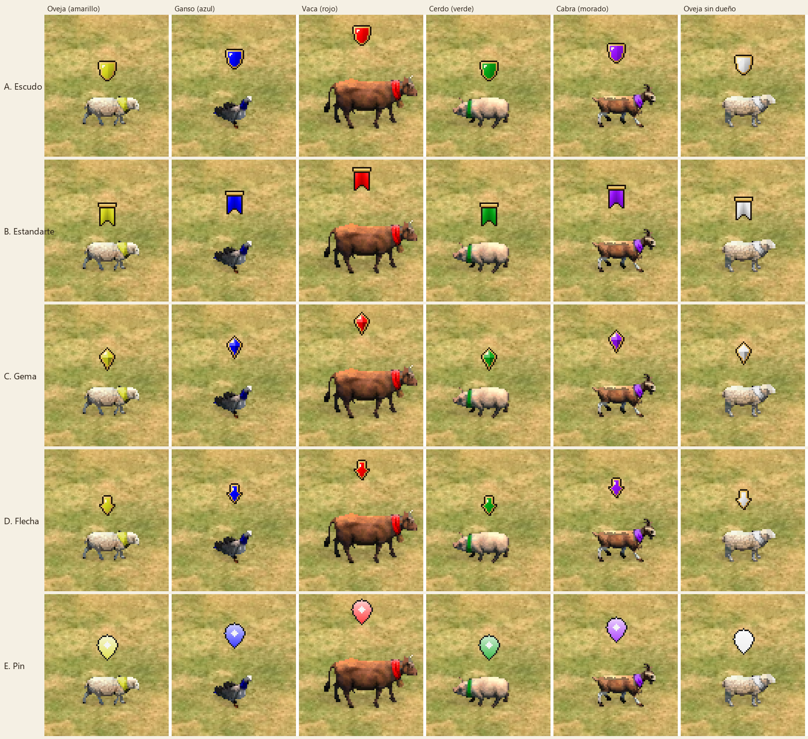

# Idea 1: Icono flotante sobre las ovejas (y todo el ganado)

- **Estado:** v3 (icono de gema) construida e instalada en `mods\local\icono-ovejas`; cubre los 17 animales de pastoreo. **Falta probarla en el juego.**
- **Tipo de mod:** gráfico (solo visual)
- **Juego:** Age of Empires II: Definitive Edition
- **Código:** [content/mods/icono-ovejas/build.py](../content/mods/icono-ovejas/build.py)
- **Nombre en el juego:** "Icono sobre el ganado"

## Qué hace

Muestra una gema tallada flotando sobre cada animal de pastoreo. La gema toma el color del jugador dueño del animal; sin dueño se ve blanca. El contorno oscuro y el engaste dorado no cambian, siguiendo el estilo de los indicadores del propio juego (como el "!" de aldeano ocioso).

Sirve para ver el ganado de lejos y saber de un vistazo qué animales son tuyos, cuáles del rival y cuáles están libres (por ejemplo, si el explorador enemigo te está robando ovejas).



En la vista previa, cada animal aparece dos veces: con color de jugador azul y sin dueño (blanco). La simulación de color está ajustada con una captura del juego, pero es aproximada.

## Historial

- **v1:** pin de mapa, solo ovejas. En la primera prueba no se veía nada porque el mapa usaba cerdos: según el mapa, el juego cambia el animal de pastoreo.
- **v2:** los 17 animales de pastoreo del juego. En el juego funcionó, pero el pin salía casi blanco y no parecía parte del juego.
- **v3:** se corrigió el color y se eligió el diseño de gema entre cuatro propuestas (escudo, estandarte, gema, flecha).



## Cómo mezcla el juego el color de jugador

Lo dedujimos de una captura y de las paletas `resources\_common\palettes\playercolor_*.pal`:

- El juego mezcla el color del jugador con el gris del píxel de la imagen principal. Un **gris medio (~128) da el color puro**, un gris claro lo lleva hacia blanco y uno oscuro hacia negro.
- El pin de la v2 usaba grises de 150 a 235 y por eso salía casi blanco. Los collares de los animales usan grises de 45 a 200 (mediana ~90-145).
- Los animales sin dueño (Gaia) se ven en blanco.
- `tools/render_sld.py` (función `tint`) implementa esta aproximación para las vistas previas.

## Cómo funciona

- **Es un mod gráfico.** Reemplaza los sprites de los animales por versiones con el icono ya dibujado, la misma técnica que usa "Anne_HK - Boar Pointer". Como no toca el archivo de datos, no choca con mods de datos y se puede usar en clasificatorias.
- **El color cambia solo.** El relleno del icono va marcado en la capa de "color de jugador", la misma que usa el collar del animal. El juego lo tiñe con el color del dueño.
- **El animal no se modifica.** El script agranda el recuadro de cada frame hacia arriba y añade el icono en bloques nuevos. Los bloques originales se copian tal cual, sin volver a comprimirlos.
- **La altura se calcula sola.** Para cada animal, el icono se coloca justo encima del punto más alto de todas sus animaciones. Así no salta al pasar de quieto a caminando.
- **Verificación automática.** Tras escribir cada archivo, el script lo vuelve a leer y comprueba bloque a bloque que la imagen, el color de jugador y la sombra del animal son idénticos al original y que el icono está en todos los frames (36.030 en total).

## Animales incluidos

| Animal | Nombre interno | Animaciones con icono | Altura del icono |
|---|---|---|---|
| Oveja | `sheep` | quieta, caminando | 32 px |
| Cerdo | `pig` | quieta, caminando | 28 px |
| Cabra | `goat` | quieta, caminando | 40 px |
| Llama / llama blanca | `llama`, `llama_white` | quieta, caminando | 48 / 50 px |
| Pavo | `turkey` | quieta, caminando | 28 px |
| Ganso | `goose` | quieta, caminando | 36 px |
| Gallinas (3 colores) | `chicken_*` | quieta (A y B), caminando | 26 px |
| Vacas (4 pelajes) | `cow_*` | quieta (A y B), caminando | 52 px |
| Búfalo | `buffalo` | quieta, caminando | 52 px |
| Capibara | `capybara` | quieta (A y B), caminando | 30 px |
| Argali | `argali` | quieta (A y B), caminando, corriendo | 33 px |

Ninguno lleva icono al morir ni como cadáver, igual que hace Boar Pointer.

Casos especiales que el script resuelve solo:

- **Punto de apoyo fuera de la rejilla.** En gallinas, llamas blancas, capibaras y argalis el punto de apoyo no cae en la rejilla de 4 píxeles. El icono se comprime una vez por cada desplazamiento posible.
- **Lienzo demasiado bajo.** La llama blanca ocupa todo el alto de su lienzo, así que se agranda hacia arriba para que quepa el icono.
- **Sin capa de color de jugador.** El argali no la tiene; se crea para que el icono cambie de color.

## Cómo reconstruir e instalar

```bash
py content/mods/icono-ovejas/build.py --install
```

- `--install` copia el mod a `mods\local\icono-ovejas` del perfil. **Hay que reiniciar el juego** para que cargue los cambios.
- `--only sheep,pig` construye solo algunos animales, útil para probar cambios rápido.
- El diseño se elige con `ICON_DESIGN` al principio de `build.py`. Los diseños están en [icons.py](../content/mods/icono-ovejas/icons.py).
- `py content/mods/icono-ovejas/compare.py` genera `preview/comparacion.png` con todos los diseños sobre animales reales.
- Cada construcción regenera `preview/todos.png` con todos los animales.

## Cómo probarlo en el juego

1. Cierra el juego del todo y vuelve a abrirlo. En el menú **Mods**, comprueba que **"Icono sobre el ganado"** esté activado.
2. Empieza una partida contra la IA.
3. Comprueba:
   - Que el icono aparece sobre el ganado, quieto y caminando.
   - Qué color tiene un animal sin dueño (Gaia) y si se distingue de los de los jugadores.
   - Que al acercar el explorador a un animal el icono cambia a tu color.
   - El tamaño y la altura con la cámara alejada.
   - Que no haya parpadeos ni cortes al cambiar de dirección.

## Lo que aprendimos del formato SLD

Detalles útiles para próximos mods gráficos, todos implementados en [tools/sld.py](../tools/sld.py):

- Cada frame tiene hasta 5 capas: principal (BC1), sombra (BC4), una máscara de 1 bit, daño (BC1) y color de jugador (BC4).
- **La máscara de 1 bit** (bit `0x04` del tipo de frame) no está bien documentada. Va alineada a la rejilla de bloques de la capa principal y se guarda fila a fila. Un byte `< 0x80` salta bloques y un byte `>= 0x80` dibuja `n` bloques de 16 bits. Casi coincide con la transparencia de la capa principal, pero no del todo, así que conservamos las filas originales y solo añadimos filas para el icono.
- **El flag `0x80` en una capa** indica que los bloques saltados se copian del frame anterior, en la misma posición del lienzo. El mod quita ese flag en las capas que modifica y escribe todos los bloques.
- **Los límites de las capas están alineados a 4 px en el lienzo**, pero el punto de apoyo (hotspot) no siempre lo está.
- La capa de color de jugador usa una imagen principal en tonos de gris: el juego multiplica ese gris por el color del jugador.

## Pendiente

- **Probar la v3 en el juego:** comprobar que la gema sale con el color de jugador bien saturado y que se lee bien con la cámara alejada.
- **Tamaño del mod (53 MB).** Las animaciones quietas se guardaban reutilizando bloques del frame anterior y ahora se guardan completas. Si se publica, conviene volver a usar la reutilización para reducirlo.
- **Versión UHD (`_x2`).** Hace falta tener los gráficos UHD instalados para generarla.
- **Tamaño de la gema (13x17 px):** si en el juego se ve pequeña, se puede agrandar en `icons.py`.
